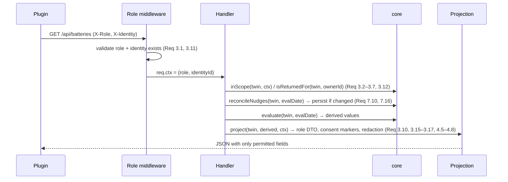
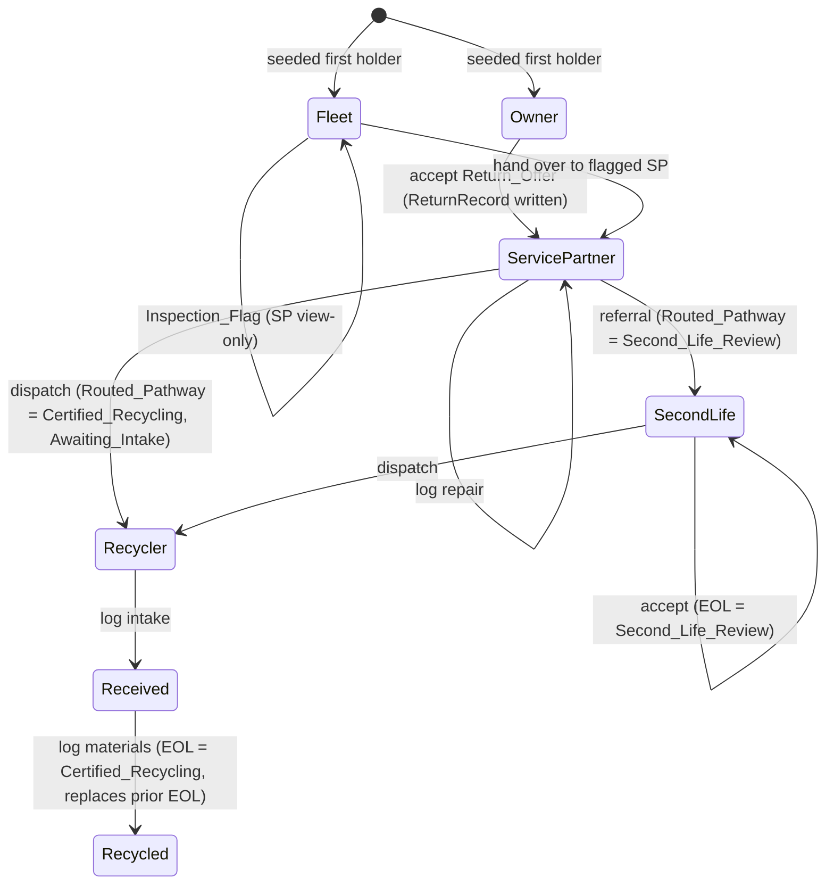

# Design Document: Battery ReRoute

## Overview

Battery ReRoute is a locally runnable prototype that joins EV battery lifecycle data into one Digital_Twin per battery and exposes role-specific views through a single embeddable Plugin. The prototype runs entirely offline on synthetic data produced by a deterministic Seed_Script.

The design has three goals:

1. **Correct, testable core logic.** Health_Model, Pathway_Recommender, Nudge_Engine, Impact_Score, Final_Impact_Score, Application_Fit, Replacement_Forecast, Scope3_Reporter, CSV export/parse, validation, and role/consent projection are pure TypeScript functions that take the Digital_Twin(s) and an explicit `evalDate`. No function in the core reads the clock, the file system, or global state. This makes every rule deterministic (Req 5.8, 6.12, 7.15, 2.8) and property-testable.
2. **Server-side enforcement.** All role scoping, field filtering, Owner-identity redaction for the ESG_Officer, Returned_Battery redaction, and consent gating happen in the API_Server before data is serialized (Req 3.10, 3.16, 3.17). The Plugin is a pure renderer of what the server returns.
3. **Minimal setup.** One Node.js package, three npm scripts (`install`, `seed`, `start`), a JSON file store, and no native modules, so it installs cleanly on Windows/PowerShell with no build tools.

### Technology choices

| Concern | Choice | Rationale |
|---|---|---|
| Language | TypeScript (strict) on Node.js 20 LTS or later | One language for core, server, seed, and UI; shared types between server and Plugin. |
| HTTP server | Express 4 | Small, well-known, trivial to test with `supertest`. |
| Validation | Zod | Schema validation that reports every failing path, which maps directly to "names each invalid field" (Req 1.9, 9.6). |
| UI | React 18 + Vite | Plugin is a single React component; Vite builds the host page. Express serves the built assets so `npm start` is one process. |
| Store | Single JSON file (`data/store.json`) with atomic write-then-rename | No native dependency (unlike `better-sqlite3`, which may need a C++ toolchain on Windows). Atomic rename gives the all-or-nothing behavior required for seeding (Req 2.13) and for rejected writes (Req 1.9). ~50 batteries fit comfortably in memory. |
| Randomness | Built-in seeded PRNG (mulberry32) in the Seed_Script | Deterministic output for a given seed and run date (Req 2.8, 2.11) without a dependency. |
| Tests | Vitest + fast-check (property tests), supertest (API), React Testing Library + jsdom (Plugin) | fast-check is the standard PBT library for TypeScript and integrates with Vitest. |
| TS runner | `tsx` | Runs the seed script and server in development without a separate compile step. |

### Research notes

- **fast-check**: provides arbitraries, shrinking, and `fc.assert(fc.property(...), { numRuns })`; integrates with Vitest via plain `it` blocks ([fast-check docs](https://fast-check.dev/)). Used for all Correctness Properties with `numRuns: 100` minimum.
- **RFC 4180** CSV: fields containing comma, double quote, CR or LF are enclosed in double quotes, and embedded double quotes are doubled; records are separated by CRLF ([RFC 4180](https://www.rfc-editor.org/rfc/rfc4180)). The exporter and parser follow that grammar exactly so the round-trip property (Req 12.11) holds.
- **GHG Protocol Scope 3 Category 12** ("End-of-life treatment of sold products") covers emissions from disposal and treatment of products a company sold; companies may use measured data or estimates ([GHG Protocol Scope 3 Technical Guidance](https://ghgprotocol.org/scope-3-technical-calculation-guidance)). The prototype only reports disposition and measurement coverage, never emissions quantities (Req 12.12, 12.13).
- **Atomic file replace**: `fs.rename` over an existing file on the same volume replaces it in one step on NTFS and POSIX file systems, so readers see either the old or the new store, never a partial write ([Node.js fs.rename](https://nodejs.org/api/fs.html#fsrenameoldpath-newpath-callback)).

## Architecture

```mermaid
flowchart LR
  subgraph Browser["Host page (React + Vite)"]
    RS[Role_Switcher]
    PL[Plugin&lt;role, identity&gt;]
    RS -- role, identity --> PL
  end

  subgraph Server["API_Server (Express)"]
    MW[Role context middleware]
    RT[Route handlers]
    SV[Services / commands]
    PJ[Role projection + consent gate + redaction]
    MW --> RT --> SV
    SV --> PJ
  end

  subgraph Core["core/ (pure functions, evalDate explicit)"]
    VAL[validation]
    HM[Health_Model]
    PR[Pathway_Recommender]
    NE[Nudge_Engine + Impact_Score + Final_Impact_Score]
    AF[Application_Fit]
    RF[Replacement_Forecast]
    S3[Scope3_Reporter]
    CSV[CSV export / parse]
    DC[Data_Confidence]
    ACC[access scope + field rules]
  end

  ST[(data/store.json)]
  SEED[Seed_Script]

  PL -- "HTTP JSON (X-Role, X-Identity)" --> MW
  SV --> Core
  PJ --> Core
  SV <--> REPO[Repository] <--> ST
  SEED --> Core
  SEED -- atomic write --> ST
```



### Layers

- **`src/core/`**: pure domain logic and types. Imports nothing from Node, Express, or React. Every evaluation function signature includes `evalDate: string` (ISO `YYYY-MM-DD`).
- **`src/server/`**: Express app factory `createApp({ repo, clock })`. `clock.today()` supplies `evalDate` and "current date"; tests inject a fixed clock. Env var `BR_TODAY` can override the clock for demos.
- **`src/server/repo/`**: `Repository` interface with `FileRepository` (JSON file, atomic writes) and `MemoryRepository` (tests). Mutations are serialized through a single in-process queue so concurrent requests cannot interleave.
- **`src/web/`**: `HostPage` (Role_Switcher + one Plugin), `Plugin` with one sub-view per role, and an `apiClient` with a 10-second timeout.
- **`scripts/seed.ts`**: builds the full dataset in memory with the seeded PRNG, validates it with the same Zod schemas, checks the seeding invariants (Req 2.1–2.7, 2.14, 14.6), and only then writes the store atomically.

### Request flow (read)



Nudge reconciliation is the only write a read can cause. It is idempotent for a fixed `evalDate`, so repeated reads on the same day write at most once and never create duplicates.

### Request flow (command)

Every mutation follows the same pattern: (1) resolve context, (2) load twin, (3) check scope, Returned_Battery status, and permitted action for role (Req 3.8, 3.9, 3.13, 3.18), (4) validate payload with Zod plus domain checks, (5) compute the new twin with a pure `apply*` function, (6) validate the whole new twin, (7) persist atomically. Any failure in steps 2–6 returns an error and nothing is written, so the stored twin is unchanged.

## Components and Interfaces

### Core: shared helpers (`core/dates.ts`, `core/telemetry.ts`)

```ts
type ISODate = string;              // 'YYYY-MM-DD'
type ISODateTime = string;          // full ISO timestamp for Telemetry

latestReading(twin, evalDate): TelemetryReading | undefined   // max timestamp <= evalDate
readingsUpTo(twin, evalDate): TelemetryReading[]               // sorted ascending
fastChargeShare(sessions, evalDate): number                    // 0..100; 0 when no sessions or zero total energy
safetyFlag(twin, evalDate): boolean                            // any thermalEventCount >= 1 or any Safety_Critical_Fault_Code
recentFault(twin, evalDate): ServiceRecord | undefined         // non-empty faultCode, date in [evalDate-90d, evalDate]
fallingSohTrend(twin, evalDate): { decline: number } | undefined // see Nudge_Engine
currentHolder(custodyLog, asOf?): CustodyEntry | undefined      // last entry dated <= asOf (or last entry)
consentStatus(twin): 'granted' | 'not_granted'                 // last ConsentEvent is 'grant'
latestInspectionFlag(twin): InspectionFlag | undefined          // last element of inspectionFlags
returnRecordFor(twin, ownerId): ReturnRecord | undefined
isReturnedFor(twin, ownerId): boolean                          // returnRecordFor(...) exists and Current_Holder is not that Owner
```

`SAFETY_CRITICAL_FAULT_CODES` is a fixed exported constant: `['THERMAL_RUNAWAY', 'CELL_VENTING', 'INTERNAL_SHORT', 'ISOLATION_FAULT', 'BMS_OVERTEMP']`.

Safety_Flag considers all Telemetry and Service_History records on or before `evalDate`.

### Core: Health_Model (`core/health.ts`)

```ts
evaluateHealth(twin, evalDate): HealthResult

type HealthResult =
  | { ok: true; healthScore: number; factors: ContributingFactor[];
      remainingLife: RemainingLife | null; remainingLifeReason?: 'INSUFFICIENT_TELEMETRY_HISTORY';
      dataConfidence: number }
  | { ok: false; reason: 'TELEMETRY_MISSING'; dataConfidence: number };

type ContributingFactor = { name: 'SoH' | 'CycleCount' | 'FastChargeShare' | 'ThermalEvents'; value: number; effect: number };
type RemainingLife = { months: number; cycles: number };
```

Scoring (inputs from the latest reading on or before `evalDate`; Fast_Charge_Share from sessions on or before `evalDate`):

| Factor | Effect (points) |
|---|---|
| SoH | `-(100 - SoH)` (range −100..0) |
| Cycle count | `-min(15, cycles / 100)` |
| Fast_Charge_Share (%) | `-min(15, FCS × 0.2)`; exactly 0 when Charging_History is empty (Req 5.11) |
| Thermal events | `-min(20, thermalEvents × 10)` |

`healthScore = clamp(round(100 + Σ effect), 0, 100)`. Each effect is non-increasing in its "bad" input, so monotonicity (Req 5.6, 5.7) holds by construction. Effects are reported rounded to one decimal place; the score is computed from unrounded effects.

Remaining_Life (Req 5.3, 5.4, 5.12):

- SoH ≤ 80 → `{ months: 0, cycles: 0 }`.
- SoH > 80 and fewer than 2 readings on or before `evalDate` → `remainingLife: null`, reason `INSUFFICIENT_TELEMETRY_HISTORY`; Health_Score still returned.
- Otherwise, using the first and last readings up to `evalDate`: `ratePerMonth = (soh_first - soh_last) / monthsBetween`, `ratePerCycle = (soh_first - soh_last) / (cycles_last - cycles_first)`. `months = floor((SoH - 80) / ratePerMonth)`, `cycles = floor((SoH - 80) / ratePerCycle)`. If a rate is ≤ 0 or its denominator is 0, that output uses the cap (`MAX_MONTHS = 180`, `MAX_CYCLES = 5000`). Results are clamped to `[0, cap]`, so they are always non-negative integers.

The Health_Model reads Owner_Data regardless of Consent (Req 4.11); consent only affects projection.

### Core: Data_Confidence (`core/confidence.ts`)

```ts
dataConfidence(twin): number    // no viewer, no role, no consent input
```

Start at 100. Subtract, each at most once: 30 (Telemetry has no readings), 20 (Charging_History has no sessions), 20 (Service_History has no records), 15 (any empty Battery_Passport field). Floor at 0 (Req 6.10). The function has no viewer or Consent parameter, so the score is the same for every Active_Role and Consent status by construction (Req 6.15). Health_Model, Pathway_Recommender, every role projection that shows the score, and Scope3_Reporter all call this one function (Req 5.10, 6.9, 12.7).

Wherever `dataConfidence` is returned, a separate `consentStatus: 'granted' | 'not_granted'` field is returned next to it (pathway result, Owner / Service_Partner / Second_Life_Provider / ESG_Officer projections, Scope3 rows, CSV rows) (Req 6.9, 12.7, 12.8).

### Core: Pathway_Recommender (`core/pathway.ts`)

```ts
recommendPathway(twin, evalDate): PathwayResult

type PathwayResult = {
  pathway: Pathway;
  firedRules: FiredRule[];         // every rule whose condition held, in precedence order
  decidingRule: RuleName;
  reason?: 'Telemetry is missing'; // only when decidingRule is MISSING_TELEMETRY
  dataConfidence: number;          // dataConfidence(twin)
  consentStatus: 'granted' | 'not_granted';
};
type RuleName = 'CERTIFIED_RECYCLING' | 'MISSING_TELEMETRY' | 'INSPECT_REPAIR' | 'CONTINUE_USE' | 'SECOND_LIFE_REVIEW';
type FiredRule = { rule: RuleName; inputs: { soh?: number; thermalEvents?: number;
  safetyCriticalFaultCode?: string; recentFaultDate?: ISODate; telemetryMissing?: true } };
```

All five rule conditions are evaluated independently (so `firedRules` is complete, Req 6.8), then the first in precedence order wins (Req 6.2):

| # | Rule | Condition | Pathway |
|---|---|---|---|
| a | CERTIFIED_RECYCLING | Safety_Flag, or latest SoH < 60 (also fires with no Telemetry when the flag comes from a fault code) | Certified_Recycling |
| b | MISSING_TELEMETRY | no readings on or before `evalDate` and no Safety_Flag | Inspect_Repair, reason "Telemetry is missing" |
| c | INSPECT_REPAIR | no Safety_Flag, SoH ≥ 60, Recent_Fault exists | Inspect_Repair |
| d | CONTINUE_USE | SoH ≥ 80, no Safety_Flag, no Recent_Fault | Continue_Use |
| e | SECOND_LIFE_REVIEW | 60 ≤ SoH < 80, no Safety_Flag, no Recent_Fault | Second_Life_Review |

The conditions cover all twins, so exactly one pathway is always assigned (Req 6.1).

The Pathway recommendation runs on full internal data regardless of Consent (Req 4.11). It is not consent-gated in responses because it is decision support, not Owner_Data; see "Consent gating" below.

### Core: Nudge_Engine (`core/nudges.ts`)

Nudges are persisted on the twin (`twin.nudges`) so the Service_Prompt creation date survives between evaluations (Req 7.16).

```ts
nudgeConditions(twin, evalDate, owner: Stakeholder, servicePartners: Stakeholder[]): NudgeCondition[]
reconcileNudges(twin, evalDate, owner, servicePartners): Nudge[]      // pure; returns the new active set
designateServicePartner(owner: Stakeholder, servicePartners: Stakeholder[]): Stakeholder
```

Conditions (evaluated only for batteries whose Current_Holder role is Owner; otherwise the active set is empty):

- **Charging_Guidance**: sessions on or before `evalDate` ≥ 1 and FCS > 40. Message includes `Math.round(FCS)` + `%` (Req 7.3).
- **Service_Prompt**: Falling_SoH_Trend. Window = readings with timestamp in `[evalDate − 180d, evalDate]`; requires ≥ 2 readings; `decline = soh(earliest in window) − soh(latest in window)`; fires when `decline ≥ 2`. Message states `decline.toFixed(1)` percentage points (Req 7.4).
- **Return_Incentive**: pathway ∈ {Second_Life_Review, Certified_Recycling}, Current_Holder role is Owner, and no ReturnRecord exists for that Owner. Contains a Return_Offer `{ offerId: '<batteryId>:<ownerId>:return', servicePartnerId, servicePartnerName }` (Req 7.5).

`reconcileNudges` rules (Req 7.10, 7.16):

1. For each type whose condition holds: if an active nudge of that type exists, keep it with its original `createdOn` (and, for Return_Incentive, its original Return_Offer); refresh the message text only. Otherwise create one with `createdOn = evalDate`.
2. For each type whose condition does not hold: drop the active nudge.
3. Output has at most one nudge per type, ordered Charging_Guidance, Service_Prompt, Return_Incentive.

`reconcileNudges` is idempotent: applying it to its own output for the same `evalDate` returns an equal set. The server persists the result only when it differs from the stored set.

`designateServicePartner(owner, servicePartners)` (Req 7.17): filter Service_Partners whose `location.state` equals `owner.location.state`; if non-empty, return the first by `name` ascending (`localeCompare` with `'en'` and `sensitivity: 'base'`, ties broken by `id`); otherwise return the first of all Service_Partners by the same ordering. The seed guarantees at least one Service_Partner (Req 13.3).

### Core: Impact_Score and Final_Impact_Score (`core/impact.ts`)

```ts
type ImpactComponents = { charging: boolean; servicing: boolean; consent: boolean; return: boolean };
impactComponents(twin, evalDate, ownerId): ImpactComponents
impactScore(components): 0 | 25 | 50 | 75 | 100        // 25 × number of true components
finalImpact(twinBeforeHandover, acceptanceDate, ownerId): { finalImpactScore: 25 | 50 | 75 | 100; components: ImpactComponents }
```

Components (Req 7.13, glossary Impact_Score):

| Component | Earned (+25) when |
|---|---|
| Charging_Component | Fast_Charge_Share over sessions on or before `evalDate` ≤ 40% (empty history counts as 0%) |
| Servicing_Component | no active Service_Prompt nudge whose `createdOn` is more than 30 days before `evalDate` |
| Consent_Component | `consentStatus(twin) === 'granted'` |
| Return_Component | a ReturnRecord exists for that Owner, or no active Return_Incentive nudge (no Return_Offer issued) |

No other scoring inputs exist. The score is computed only for batteries whose Current_Holder role is Owner (Req 7.13) and is deterministic for unchanged inputs (Req 7.15). The Owner view shows the components next to the score (Req 7.14).

`finalImpact` is computed on the twin as it stands immediately before the Return_Offer handover (nudges reconciled for the acceptance date, Consent before the handover), with `return` forced to `true`. The result is therefore always in {25, 50, 75, 100} (Req 7.19, 7.20).

### Core: Application_Fit, Usable_Capacity (`core/secondLife.ts`)

```ts
usableCapacity(capacityKwh, soh): number        // capacity × soh / 100
applicationFit(twin, evalDate): ApplicationFit   // 'None' | ['Stationary_Storage'] | ['Light_Mobility'] | both
```

`None` when no Telemetry, Safety_Flag present, or neither threshold holds. Otherwise Stationary_Storage when SoH ≥ 60 and UC ≥ 10.0; Light_Mobility when SoH ≥ 70 and UC ≥ 2.0 (Req 10.2). Displayed UC is rounded to one decimal place; threshold comparisons use the unrounded value.

### Core: Replacement_Forecast (`core/forecast.ts`)

```ts
replacementForecast(fleetTwins, evalDate): { quarter: string /* '2025-Q3' */; count: number }[]  // length 4
```

Quarters Q0..Q3 start with the calendar quarter containing `evalDate`. For each battery with Remaining_Life available and `months ≤ 12`: `target = addMonths(evalDate, months)`; index = quarter offset of `target` from Q0, capped at 3 (Req 8.8). Batteries with unknown or > 12 months are excluded (Req 8.9).

### Core: Scope3_Reporter and CSV (`core/scope3.ts`, `core/csv.ts`)

```ts
validatePeriod(start?: string, end?: string): Result<Period, ValidationError>
buildScope3Report(twins, stakeholders, manufacturer, period): Scope3Report
toCsv(report): string
parseScope3Csv(csv): Scope3CsvReport     // throws on malformed input
csvEscape(field: string): string
```

- Inclusion: manufacturer equals and manufacture date ≤ period end (Req 12.2). Period start is used only for validation and display.
- Disposition: computed from End_Of_Life_Record (if dated ≤ end) and `currentHolder(custodyLog, end)` using rules (a)–(d) of Req 12.3, first match wins.
- Measurement_Status: Measured if an EOL record dated ≤ end exists, or any Custody_Log handover dated ≤ end has to-holder role Second_Life_Provider or Recycler; else Estimated (Req 12.4).
- Per-battery row: `dataConfidence(twin)` and `consentStatus(twin)` as separate fields (Req 12.7), `eolDate` (empty when no EOL ≤ end), and the ESG-filtered custody log (see projection).
- Counts: all four keys always present; they sum to the battery total (Req 12.5).
- `notYetEolCount` = count of In_Use, labeled "not yet at end of life" (Req 12.9, 12.18).
- Measured_Share (Req 12.6, 12.16, 12.17): `d` = number of batteries with Disposition Second_Life, Recycled, or Unknown; `m` = those with Measured. In_Use is excluded from both. If `d = 0` → `"0.0"`. Otherwise integer arithmetic avoids float error: `tenths = Math.floor((2000 × m + d) / (2 × d))` (this is `m / d × 1000` rounded half-up), formatted as `(tenths / 10).toFixed(1)`. Example: 1 of 3 → `floor(2003 / 6) = 333` → `33.3`.

CSV layout (CRLF line endings, no custody data, so no holder identities, Req 12.8):

```
battery_id,disposition,measurement_status,data_confidence_score,consent_status,eol_date
BR-0001,Recycled,Measured,85,granted,2025-04-02
...
summary_key,summary_value
manufacturer,"Volt, Inc."
period_start,2025-01-01
period_end,2025-12-31
count_In_Use,30
count_Second_Life,4
count_Recycled,6
count_Unknown,2
not yet at end of life,30
measured_share,83.3
```

Battery rows have 6 fields; summary rows have 2 fields, so the parser distinguishes sections by the `summary_key,summary_value` row and field count. An empty report has the header row, the summary header, and the summary rows with zeros and `0.0` (Req 12.17). Every field goes through `csvEscape` (Req 12.10). The parser is a small RFC 4180 state machine (quoted/unquoted field, doubled-quote escape, CRLF or LF record end).

### Core: access rules and projection (`core/access.ts`, `core/projection.ts`)

```ts
type ViewerContext = { role: Role; identityId: string; manufacturer?: string };
inScope(twin, viewer): boolean
allowedActions(twin, viewer): Set<Action>
ownerDataVisible(twin, viewer): boolean
project(twin, derived: Derived, viewer, stakeholders): RoleView      // discriminated union by role
projectReturned(record: ReturnRecord): OwnerReturnedBatteryView
```

Scope and fields per role (Req 3.2–3.7):

| Role | Battery scope | Fields returned |
|---|---|---|
| Owner | `batteries`: Current_Holder = this Owner. `returnedBatteries`: twins with a ReturnRecord for this Owner and Current_Holder ≠ this Owner | batteries: batteryId, healthScore, factors, impactScore, impactComponents, nudges, remainingLife, pathway, dataConfidence, returnOffer, consentStatus. returnedBatteries: batteryId, returnDate, servicePartnerName, finalImpactScore, components |
| Fleet_Operator | Current_Holder = this Fleet_Operator | batteryId, healthScore, soh, sohSeries, remainingLife, replacementForecast (list-level), safetyFlag, recentFault, inspectionFlag (`{ flagged, flagDate?, servicePartnerId?, servicePartnerName? }` from the most recent flag), consentStatus |
| Service_Partner | Current_Holder = this SP, or a ReturnRecord designating this SP, or the most recent Inspection_Flag selects this SP | batteryId, serviceHistory (reverse chronological), faultCodes, modules, pathway, dataConfidence, consentStatus, assignment (`Assigned` / `ReferredForInspection`), actionsEnabled, actionsDisabledReason? |
| Second_Life_Provider | Routed_Pathway = Second_Life_Review and Current_Holder = this SLP | batteryId, capacityKwh, soh, usableCapacity, safetyHistory, applicationFit, acceptance, pathway, dataConfidence, consentStatus |
| Recycler | Routed_Pathway = Certified_Recycling and last Custody entry is a handover to this Recycler | batteryId, chemistry, packMassKg, location (city/state of that handover's from-holder), expectedArrival, intakeStatus |
| ESG_Officer | passport.manufacturer = officer's manufacturer | batteryId, disposition, custodyLog (ESG-filtered), measurementStatus, dataConfidence, consentStatus |

`project` builds each DTO by explicitly listing fields (no spreading of the twin), so unlisted fields cannot leak (Req 3.10).

Service_Partner `assignment` and `actionsEnabled` (Req 9.1, 9.9, 3.13, 3.14): `Assigned` with `actionsEnabled: true` when the SP is the Current_Holder; `ReferredForInspection` with `actionsEnabled: false` and `actionsDisabledReason: 'Custody handover from the Fleet_Operator is pending'` when visible only through an Inspection_Flag while a Fleet_Operator holds custody; `Assigned` with `actionsEnabled: false` when visible only through a past ReturnRecord after custody moved on.

**ESG custody filtering (Req 3.15, 3.16, 4.9).** Each custody entry is projected to `{ date, toRole }`, plus `toHolderId` and `toHolderName` only when `toRole ∈ {Fleet_Operator, Service_Partner, Second_Life_Provider, Recycler}`. There is no from-holder field. The Data_Owner identity is never part of the ESG DTO, Scope3_Report, or CSV. A final `assertNoOwnerIdentity(body, ownerIds)` guard in the ESG route handlers checks the serialized body against all Owner-role ids and names and returns `INTERNAL` instead of leaking if the check fails.

**Returned_Battery redaction (Req 3.2, 3.17, 7.22).** `projectReturned` reads only the immutable ReturnRecord, never the live twin, so no Service_History, Custody_Log, Telemetry, Routed_Pathway, or End_Of_Life_Record written after the handover can reach the Owner.

**Consent gating (Req 4.4–4.8).** `ownerDataVisible(twin, viewer)`:

1. `true` if the viewer is the Data_Owner (the Owner, or the Fleet_Operator for fleet batteries, Req 4.4).
2. `true` if the viewer is the Current_Holder and the holder role is Service_Partner, Second_Life_Provider, or Recycler, regardless of Consent (Req 4.8).
3. Otherwise `true` only if the Current_Holder is the Data_Owner and Consent is granted (Req 4.7).
4. Otherwise `false`.

When `ownerDataVisible` is false and the Current_Holder is the Data_Owner, `project` replaces each Owner_Data field group the role would otherwise receive with `{ withheld: true, reason: 'Owner data withheld pending consent' }` (Req 4.5, 4.6). Gated groups: `health` (healthScore, factors, remainingLife), `soh` (soh, sohSeries, usableCapacity, applicationFit), `telemetry` (thermal event count in safety history), `charging` (Fast_Charge_Share), and `dataOwner`. Not gated: Battery_Passport, Custody_Log, End_Of_Life_Record fields (Req 4.10), Service_History, Module_Condition, Pathway recommendation, Data_Confidence_Score, consentStatus, and the Safety_Flag / Recent_Fault booleans.

> Design decision: Pathway recommendation and the Safety_Flag boolean stay visible without Consent because they are decision-support and safety outputs needed by a Service_Partner viewing an inspection-flagged battery. Raw and derived usage values (SoH, Health_Score, etc.) are withheld. If stricter gating is preferred, Pathway and Safety_Flag can be added to the withheld groups without changing other components.

Projection reads current Consent on every request, so a grant or withdrawal applies from the first request after it is recorded (Req 4.5, 4.7).

### Core: command functions (`core/commands.ts`)

Each returns `Result<CommandOutput, DomainError>` and never mutates its input:

```ts
appendCustody(twin, entry, today)                                         // Req 1.11, 1.13
recordConsent(twin, actor, type: 'grant' | 'withdraw', at)                // Req 4.1, 4.2, 4.12, 4.13, 4.14
acceptReturnOffer(twin, owner, servicePartners, today)                    // Req 7.6, 7.7, 7.11, 7.18–7.21
flagInspection(twin, fleetOperatorId, servicePartnerId, today)            // Req 8.6, 8.10
handOverToServicePartner(twin, fleetOperatorId, today)                    // Req 8.12, 8.13, 3.14
logRepair(twin, spId, payload, today)                                     // Req 9.2, 9.3, 9.6
referToSecondLife(twin, spId, slpId, today)                               // Req 9.4, 9.7
dispatchToRecycler(twin, actor, recyclerId, expectedArrival, today)       // Req 9.5, 10.4, 10.8
acceptSecondLife(twin, slpId, today, evalDate)                            // Req 10.3, 10.6, 10.7
logIntake(twin, recyclerId, intakeDate, today)                            // Req 11.3, 11.4
logMaterials(twin, recyclerId, materials, today)                          // Req 11.5–11.7, 1.10
```

Owner guard (Req 3.18, 4.14): before any Owner command, `isReturnedFor(twin, ownerId)` → `ACTION_NOT_PERMITTED` and no change. This runs before the Data_Owner check, so a returned Owner who is still the Data_Owner is rejected.

`acceptReturnOffer` steps, all in one pure function so the result is written in one atomic store write:

1. Reject with `OFFER_NOT_ACCEPTABLE` if the requester is not the Current_Holder, there is no active Return_Incentive, or a ReturnRecord already exists for that Owner.
2. `pre = reconcileNudges(twin, today, …)`; `final = finalImpact({...twin, nudges: pre}, today, ownerId)`.
3. Append the handover `{ date: today, fromHolderId: ownerId, toHolderId: offer.servicePartnerId, toHolderRole: 'Service_Partner' }` via `appendCustody`.
4. Remove the Return_Incentive nudge (the offer is accepted).
5. Append `ReturnRecord { batteryId, ownerId, returnDate: today, offerId, servicePartnerId, servicePartnerName, finalImpactScore, components }`.
6. Return `{ twin, confirmation: { message: 'Return accepted, +25 Impact points', servicePartnerName, acceptanceDate: today, finalImpactScore, components } }`.

No command modifies or removes an existing ReturnRecord; the schema validation in step (6) of the command flow compares old and new `returnRecords` and rejects any change other than an append (Req 7.21).

`handOverToServicePartner`: the actor must be a Fleet_Operator who is the Current_Holder (`NOT_CURRENT_HOLDER` otherwise) and the twin must have at least one Inspection_Flag (`NO_INSPECTION_FLAG` otherwise). It appends `{ date: today, fromHolderId: fleetOperatorId, toHolderId: latestInspectionFlag.servicePartnerId, toHolderRole: 'Service_Partner' }`. After this the Service_Partner is Current_Holder and `allowedActions` includes repair, referral, and dispatch.

### API_Server (`src/server/`)

Role context comes from headers `X-Role` and `X-Identity` (Role_Switcher stand-in for authentication, Req 14.11). Middleware rejects missing/invalid role or unknown identity with `400 INVALID_ROLE_CONTEXT` before any data access (Req 3.1, 3.11).

| Method | Path | Roles | Purpose |
|---|---|---|---|
| GET | `/api/stakeholders` | none required | Role_Switcher list: identities grouped by role, names sorted (no battery data) |
| GET | `/api/batteries` | all | Scoped, projected list (empty list when none, Req 3.12). Owner response: `{ batteries, returnedBatteries }` |
| GET | `/api/batteries/:id` | all | Single projected battery; 403 `ACCESS_DENIED` for missing or out-of-scope (Req 3.8). For an Owner's Returned_Battery, returns only the returned view |
| GET | `/api/fleet/forecast` | Fleet_Operator | Replacement_Forecast |
| POST | `/api/batteries/:id/consent` | Owner, Fleet_Operator | `{ action: 'grant' \| 'withdraw' }` |
| POST | `/api/batteries/:id/return-offer/accept` | Owner | Accept Return_Offer; returns confirmation payload |
| POST | `/api/batteries/:id/inspection-flag` | Fleet_Operator | `{ servicePartnerId }` |
| POST | `/api/batteries/:id/handover` | Fleet_Operator | Hand over to the SP named in the most recent Inspection_Flag |
| POST | `/api/batteries/:id/repairs` | Service_Partner | `{ date, faultCode, actionTaken, modulesReplaced[] }` |
| POST | `/api/batteries/:id/referral` | Service_Partner | `{ secondLifeProviderId }` |
| POST | `/api/batteries/:id/dispatch` | Service_Partner, Second_Life_Provider | `{ recyclerId, expectedArrivalDate }` |
| POST | `/api/batteries/:id/second-life/accept` | Second_Life_Provider | Accept battery |
| POST | `/api/batteries/:id/intake` | Recycler | `{ intakeDate }` |
| POST | `/api/batteries/:id/materials` | Recycler | `{ materials: { [name]: kg } }` |
| GET | `/api/scope3?manufacturer=&start=&end=` | ESG_Officer | Scope3_Report JSON |
| GET | `/api/scope3.csv?manufacturer=&start=&end=` | ESG_Officer | CSV download |
| POST | `/api/internal/twins` | internal (tests only) | Create twin, Req 1.1, 1.9, 1.12 |
| GET | `/api/internal/twins/:id` | internal (tests only) | Unfiltered twin, Req 1.14 |

Internal routes are mounted only when `createApp({ internal: true })` is used (tests). The default `npm start` app does not expose them, so no unfiltered data leaves the server in the demo.

The role/action permission matrix is a single table in `core/access.ts`; any action not listed for the role returns 403 `ACTION_NOT_PERMITTED` with no write (Req 3.9). Repair, referral, and dispatch require the Service_Partner to be the Current_Holder, so a Service_Partner linked only through an Inspection_Flag while a Fleet_Operator holds custody is rejected until `handover` runs (Req 3.13, 3.14).

The server binds to `127.0.0.1` only. There is no authentication by design (prototype); the README states this.

### Plugin and host page (`src/web/`)

```tsx
<HostPage>                      // Req 13.5
  <RoleSwitcher value={{role, identityId}} onChange={...} />   // Req 13.3, 13.4
  <Plugin role={role} identityId={identityId} />              // exactly two inputs, Req 13.1
</HostPage>
```

- `Plugin` validates its inputs against `/api/stakeholders`; invalid role or identity shows a message and renders no twin data (Req 13.9).
- One sub-view per role: `OwnerView`, `FleetView`, `ServicePartnerView`, `SecondLifeView`, `RecyclerView`, `EsgView`.
- `useRoleData(role, identityId)` fetches with an `AbortController` timeout of 10 s. While pending it shows `<div role="status" aria-label="Loading battery data">` (Req 13.7). On error or timeout it keeps the last successful data and shows `<div role="alert">` naming the failed operation (Req 13.8). Stale responses from a superseded selection are discarded.
- **OwnerView**: per held battery, Health_Score with factors, Impact_Score with the four components marked "+25" / "0" and the label "Reflects owner behaviors; not an emissions-reduction figure" (Req 7.9, 7.14), Remaining_Life months and cycles, Pathway with Data_Confidence_Score, Nudges, Consent status and toggle, Return_Offer accept button. After acceptance it shows "Return accepted, +25 Impact points" with the Service_Partner name and acceptance date (Req 7.18). A "Returned batteries" section lists returned entries and is not rendered when the list is empty (Req 7.22, 7.23); returned entries render no buttons or inputs (Req 7.24). Empty held list → "No batteries are held" (Req 7.2).
- **FleetView**: list ordered by Health_Score ascending, SoH chart or "No SoH history available", forecast, Consent toggles, inspection flag form, and for flagged batteries a "Hand over to {servicePartnerName}" button (Req 8.1–8.5, 8.11).
- **ServicePartnerView**: when `actionsEnabled` is false, repair/referral/dispatch controls are rendered with `disabled` and the `actionsDisabledReason` message is shown (Req 9.9).
- Shared components: `PathwayBadge` (renders pathway name, the "Decision support" label, and `ValidationNotice` adjacent when the pathway, Routed_Pathway, or EOL pathway is Second_Life_Review or Certified_Recycling, Req 6.13, 6.14), `ValidationNotice` (exact text "Certified specialist validation required"), `WithheldMarker`, `SohChart` (inline SVG line chart with an accessible `<title>` and a visually hidden data table, no chart library).
- **EsgView**: report table with consent status column, counts, "not yet at end of life" count shown separately from Measured_Share, no-emissions statement, period form that keeps entered dates on error, empty-report message (Req 12.1, 12.13, 12.14, 12.17, 12.18).
- Mutations update UI from the server response; Consent toggles show the new status only after the server confirms, otherwise they keep the previous status and show an error (Req 7.8, 7.12).
- Accessibility (Req 13.6): only native `<button>`, `<input>`, `<select>`, `<label>` elements; no `div` click handlers; a global `:focus-visible` outline; every control has a visible label or `aria-label`. Full WCAG conformance needs manual testing with assistive technologies, which is outside automated tests.

### Seed_Script (`scripts/seed.ts`)

```
npm run seed               # default seed 20250101
npm run seed -- --seed 42
```

1. Parse `--seed`; non-integer → print error, exit code 1, store untouched (Req 2.12). Missing → `DEFAULT_SEED` (Req 2.11).
2. `runDate = BR_TODAY ?? today`. All dates are generated as offsets from `runDate`, so same seed + same run date yields identical output (Req 2.8).
3. Create stakeholders (≥ 1 per role, each with a city/state Location, ≥ 2 Service_Partners in different states so designation is demonstrable, Req 2.6, 13.3), then twins from archetype templates that target each Pathway, fleet membership, holders, Consent ratio, EOL records, Routed_Pathways, and missing-record cases (Req 2.2–2.6).
4. Telemetry generator: SoH is non-increasing across readings except immediately after a Service_History record that replaces modules (Req 2.10).
5. Any twin that leaves its Data_Owner toward a Service_Partner and later a Second_Life_Provider gets a Consent grant dated on or before that first handover, with no withdrawal after it until the handover (Req 2.14).
6. Run `reconcileNudges(twin, runDate, …)` for Owner-held twins; selected archetypes get a backdated Service_Prompt `createdOn` (e.g., 45 days before `runDate`) so both Servicing_Component outcomes are demonstrable.
7. Add the demo battery `BR-DEMO-0001` per Req 14.6.
8. Validate every twin with the Zod schemas and run `checkSeedInvariants(dataset, runDate)`, which recomputes pathways and checks:
   - counts and ratios of Req 2.1–2.6;
   - consent rule (Req 2.14): every twin with Routed_Pathway Second_Life_Review or Current_Holder role Second_Life_Provider has a Data_Owner grant dated on or before the first Custody_Log handover away from the Data_Owner, and no withdrawal between that grant and that handover;
   - demo battery (Req 14.6): exactly one `BR-DEMO-0001`, Current_Holder role Owner, Consent not granted, no End_Of_Life_Record, no Routed_Pathway, no handover to a Service_Partner, Second_Life_Provider, or Recycler, no ReturnRecord, and `recommendPathway(...).pathway === 'Second_Life_Review'` on `runDate`.
   Any failure throws.
9. Write to `data/store.json.tmp`, then rename over `data/store.json` (Req 2.9, 2.13, 14.7). On any thrown error before the rename, print "Seeding failed: …" and exit 1.

## Data Models

TypeScript types in `src/core/types.ts`; the Zod schemas in `src/core/schemas.ts` mirror them and enforce the ranges in Req 1.

```ts
type Role = 'Owner' | 'Fleet_Operator' | 'Service_Partner' | 'Second_Life_Provider' | 'Recycler' | 'ESG_Officer';
type HolderRole = Exclude<Role, 'ESG_Officer'>;
type Pathway = 'Continue_Use' | 'Inspect_Repair' | 'Second_Life_Review' | 'Certified_Recycling';
type EolPathway = 'Second_Life_Review' | 'Certified_Recycling';
type ModuleCondition = 'Good' | 'Degraded' | 'Failed';
type ConsentStatus = 'granted' | 'not_granted';
type IntakeStatus = 'Awaiting_Intake' | 'Received';

interface Location { city: string; state: string }       // never a street address

interface Stakeholder {
  id: string;                 // e.g. 'OWN-001', 'FLT-001', 'SP-001'
  role: Role;
  name: string;
  location: Location;
  manufacturer?: string;      // ESG_Officer only
}

interface BatteryPassport {
  batteryId: string;          // 1..64 chars
  chemistry: string;          // 1..64 chars ('' allowed only in seeded missing-record twins)
  capacityKwh: number;        // (0, 500]
  packMassKg: number;         // > 0
  manufactureDate: ISODate;   // <= write date
  manufacturer: string;       // 1..128 chars
  embeddedCarbonKgCo2e: number; // >= 0
  recycledContentPct: number; // [0, 100]
}

interface Module { moduleId: string; condition: ModuleCondition }   // replacement sets 'Good'

interface TelemetryReading { timestamp: ISODateTime; sohPct: number; cycleCount: number; thermalEventCount: number }

interface ChargingSession { date: ISODate; energyKwh: number; chargeType: 'DC_Fast' | 'AC'; ambientTempC: number } // energy >= 0, temp [-50, 60]

interface ServiceRecord { date: ISODate; faultCode: string; actionTaken: string; modulesReplaced: string[] }
// faultCode '' or 1..32 chars; actionTaken 0..500 seeded, 1..500 via Platform

interface CustodyEntry {
  date: ISODate;
  fromHolderId: string | null;  // null for the first (manufacturer-to-first-holder) entry
  toHolderId: string;
  toHolderRole: HolderRole;
  expectedArrivalDate?: ISODate; // dispatch-to-Recycler entries only
}

interface ConsentEvent { type: 'grant' | 'withdraw'; at: ISODateTime; byId: string }

interface InspectionFlag { flagDate: ISODate; fleetOperatorId: string; servicePartnerId: string }

type Nudge =
  | { type: 'Charging_Guidance'; createdOn: ISODate; message: string }
  | { type: 'Service_Prompt'; createdOn: ISODate; message: string }       // createdOn retained while active
  | { type: 'Return_Incentive'; createdOn: ISODate; message: string;
      returnOffer: { offerId: string; servicePartnerId: string; servicePartnerName: string } };

interface ReturnRecord {                 // Returned_Battery entry; written once, immutable
  batteryId: string;
  ownerId: string;
  offerId: string;
  returnDate: ISODate;                   // acceptance date
  servicePartnerId: string;
  servicePartnerName: string;
  finalImpactScore: 25 | 50 | 75 | 100;
  components: ImpactComponents;          // return === true
}

interface RecyclerIntake { handoverIndex: number; intakeDate: ISODate }   // kept separate so Custody_Log entries stay immutable

interface EndOfLifeRecord { pathway: EolPathway; date: ISODate; receivingPartyId: string; materialsRecoveredKg: Record<string, number> }

interface DigitalTwin {
  passport: BatteryPassport;
  modules: Module[];                       // length >= 1
  telemetry: TelemetryReading[];
  chargingHistory: ChargingSession[];
  serviceHistory: ServiceRecord[];
  custodyLog: CustodyEntry[];              // length >= 1, append-only, dates non-decreasing
  endOfLife: EndOfLifeRecord | null;
  dataOwner: { id: string; role: 'Owner' | 'Fleet_Operator' };   // part of Owner_Data
  consentEvents: ConsentEvent[];           // chronological, append-only
  routedPathway: EolPathway | null;
  inspectionFlags: InspectionFlag[];       // append-only; last is "most recent"
  nudges: Nudge[];                         // active set, at most one per type
  returnRecords: ReturnRecord[];           // append-only, at most one per ownerId
  recyclerIntake: RecyclerIntake | null;
}

interface Store {
  version: 2;
  seed: number;
  runDate: ISODate;
  stakeholders: Stakeholder[];
  twins: Record<string, DigitalTwin>;     // keyed by batteryId → exactly one twin per ID
}
```

### Report and view models

```ts
interface EsgCustodyEntry { date: ISODate; toRole: HolderRole; toHolderId?: string; toHolderName?: string } // id/name only for non-Owner roles

interface Scope3Row {
  batteryId: string; disposition: Disposition; measurementStatus: 'Measured' | 'Estimated';
  dataConfidence: number; consentStatus: ConsentStatus; eolDate: ISODate | '';
  custodyLog: EsgCustodyEntry[];          // JSON only, never in CSV
}
interface Scope3Report {
  manufacturer: string; periodStart: ISODate; periodEnd: ISODate;
  rows: Scope3Row[];
  counts: Record<Disposition, number>;    // all four keys
  notYetEolCount: number;                 // === counts.In_Use, labeled "not yet at end of life"
  measuredShare: string;                  // one decimal, e.g. '33.3'
}
type Scope3CsvReport = Omit<Scope3Report, 'rows'> & { rows: Omit<Scope3Row, 'custodyLog'>[] };

interface OwnerReturnedBatteryView {
  batteryId: string; returnDate: ISODate; servicePartnerName: string;
  finalImpactScore: 25 | 50 | 75 | 100; components: ImpactComponents;
}
interface ReturnConfirmation {
  message: 'Return accepted, +25 Impact points'; servicePartnerName: string;
  acceptanceDate: ISODate; finalImpactScore: 25 | 50 | 75 | 100; components: ImpactComponents;
}
```

### Derived values (never stored)

| Value | Source |
|---|---|
| Current_Holder | last Custody_Log entry |
| Consent status | last ConsentEvent is `grant` → `granted`, else `not_granted` |
| Return_Offer accepted | ReturnRecord exists for that Owner |
| Returned_Battery (for Owner X) | ReturnRecord for X exists and Current_Holder ≠ X |
| Intake_Status | `recyclerIntake` set for the latest dispatch handover → Received, else Awaiting_Intake (when Routed_Pathway is Certified_Recycling) |
| Second-life acceptance | `endOfLife?.pathway === 'Second_Life_Review'` → Accepted, else Pending |
| Recycler Location | Location of the from-holder of the latest handover |
| Health, Pathway, Impact, Fit, Forecast, Disposition, Measurement_Status, Data_Confidence | core functions with `evalDate` |

### State transitions



## Correctness Properties

*A property is a characteristic or behavior that should hold true across all valid executions of a system-essentially, a formal statement about what the system should do. Properties serve as the bridge between human-readable specifications and machine-verifiable correctness guarantees.*

Most of the platform is pure rule logic (scoring, decision tables, forecasting, reporting, CSV) and state-transition commands over a Digital_Twin, so property-based testing applies well here. UI rendering, seeding coverage counts, timing, and README content are covered by example, smoke, and integration tests instead (see Testing Strategy).

After reflection, overlapping criteria were merged: field-range criteria (1.2–1.9) into one validation property; consent grant/withdraw/history into one event-log property; the five pathway rules into one model-based property; Data_Confidence formula, role independence, and the separate consent field into Property 21; Returned_Battery redaction (3.17, 7.22) into Property 43; Owner write rejection on Returned_Batteries (3.18, 4.14) into Property 44; and the CSV row/summary criteria into the round-trip property.

### Property 1: Validation rejects exactly the invalid fields, atomically

*For any* valid Digital_Twin write payload and any non-empty set of fields replaced with out-of-range or missing values (per Req 1.1–1.8), the API_Server rejects the request with a validation error whose list of named fields equals that set, and the stored data is identical before and after the request. *For any* payload with no invalid fields, the write is accepted.

**Validates: Requirements 1.1, 1.2, 1.3, 1.4, 1.5, 1.6, 1.7, 1.8, 1.9**

### Property 2: Create/retrieve round trip and uniqueness

*For any* valid Digital_Twin, creating it and then retrieving it internally by battery ID returns an equal Battery_Passport, modules, Telemetry, Charging_History, Service_History, Custody_Log, and End_Of_Life_Record; creating a second twin with the same battery ID is rejected as a duplicate and the stored twin remains equal to the first; retrieving any battery ID not stored returns not-found.

**Validates: Requirements 1.1, 1.12, 1.14**

### Property 3: Custody_Log is append-only

*For any* Custody_Log and any handover, if the handover date is not earlier than the last entry's date then the new log equals the old log with the handover appended and Current_Holder equals the handover's to-holder and role; otherwise the request is rejected and the log is unchanged.

**Validates: Requirements 1.11, 1.13**

### Property 4: Seed determinism

*For any* integer seed and run date, running the Seed_Script generator twice produces deeply equal datasets; running it without a seed produces the same dataset as running it with `DEFAULT_SEED`.

**Validates: Requirements 2.8, 2.11**

### Property 5: Seeded Telemetry is in range and non-increasing except across module replacement

*For any* integer seed, every generated SoH is in [0, 100], and for each twin, for every pair of consecutive readings in timestamp order where SoH increases, a Service_History record with at least one module replaced is dated between those two readings.

**Validates: Requirements 2.10**

### Property 6: Non-integer seeds are rejected

*For any* string that does not represent an integer, `parseSeed` returns an invalid-seed error and the seed run performs no write to the store.

**Validates: Requirements 2.12**

### Property 7: Role scope and field whitelist

*For any* dataset and any valid viewer (role and identity), every battery in the list response satisfies the role's scope rule (Owner: Current_Holder, plus `returnedBatteries` from ReturnRecords; Second_Life_Provider: Routed_Pathway Second_Life_Review and Current_Holder; Recycler: Routed_Pathway Certified_Recycling and latest handover to that Recycler; ESG_Officer: matching manufacturer; others per Req 3.3, 3.4), every in-scope battery is present, the response is an empty list when none are in scope, and each returned battery object's key set equals the permitted field set for that role (with consent markers allowed in place of gated groups).

**Validates: Requirements 3.2, 3.3, 3.4, 3.5, 3.6, 3.7, 3.10, 3.12, 12.1**

### Property 8: Uniform access denial

*For any* viewer and any battery ID that is either not stored or not in that viewer's scope (including ESG requests for another manufacturer's batteries, reports, or exports), the response is the same access-denied error with an identical body, and contains no battery data.

**Validates: Requirements 3.8, 12.15**

### Property 9: Invalid role context returns no data

*For any* request whose role header is missing or not one of the six roles, or whose identity is missing or not a stored identity of that role, the API_Server returns an invalid-role-context error with no battery data.

**Validates: Requirements 3.1, 3.11**

### Property 10: Disallowed actions are no-ops

*For any* twin, viewer, and action not in `allowedActions(twin, viewer)` (including repair, referral, and dispatch by a Service_Partner linked only through an Inspection_Flag while a Fleet_Operator holds custody), the command is rejected with access-denied and the twin is deeply equal before and after.

**Validates: Requirements 3.9, 3.13**

### Property 11: Consent is the last event, history is append-only

*For any* twin and any sequence of grant/withdraw operations by the Data_Owner, `consentStatus` equals `granted` iff the last operation was a grant (and `not_granted` for the empty sequence), and the recorded events equal the operations in order, each with its timestamp and the Data_Owner identity; earlier events are never modified.

**Validates: Requirements 4.1, 4.2, 4.3, 4.13**

### Property 12: Only the Data_Owner can change Consent

*For any* non-returned twin and any stakeholder, a Consent change succeeds iff the stakeholder is the twin's Data_Owner (the Owner, or the Fleet_Operator for fleet batteries); otherwise it is rejected and the Consent events are unchanged.

**Validates: Requirements 4.4, 4.12**

### Property 13: Consent gates Owner_Data per ownerDataVisible

*For any* twin and viewer, `ownerDataVisible` is true iff the viewer is the Data_Owner, or the viewer is the Current_Holder with role Service_Partner, Second_Life_Provider, or Recycler, or the Current_Holder is the Data_Owner and Consent is granted. When it is true the projection contains the Owner_Data groups permitted for the role; when it is false and the Current_Holder is the Data_Owner, each such group is replaced by the withheld-pending-consent marker and no Owner_Data value appears anywhere in the serialized response.

**Validates: Requirements 4.4, 4.5, 4.6, 4.7, 4.8**

### Property 14: Consent does not affect non-owner data, internal results, or Data_Confidence_Score

*For any* twin, viewer, and evaluation date, toggling Consent leaves unchanged the projected Battery_Passport, Custody_Log, and End_Of_Life_Record fields, the Pathway result (other than `consentStatus`), Safety_Flag, Health result, Disposition, Measurement_Status, and the Data_Confidence_Score, which is exactly equal before and after; only `consentStatus`, the Consent_Component, and consent-gated groups may differ.

**Validates: Requirements 4.10, 4.11, 6.15**

### Property 15: Health result shape and range

*For any* twin and evaluation date with at least one reading on or before that date, the Health_Model returns an integer Health_Score in [0, 100] and exactly four Contributing_Factors named SoH, CycleCount, FastChargeShare, ThermalEvents, each with a numeric effect, where the FastChargeShare effect is 0 when Charging_History is empty; *for any* twin with no such reading, it returns no score, no Remaining_Life, the reason TELEMETRY_MISSING, and does not modify the twin.

**Validates: Requirements 5.2, 5.5, 5.9, 5.11**

### Property 16: Health_Score monotonicity

*For any* twin, increasing only the latest SoH never lowers the Health_Score, and increasing only the Fast_Charge_Share, cycle count, or thermal event count never raises it.

**Validates: Requirements 5.6, 5.7**

### Property 17: Evaluation-date cutoff

*For any* twin and evaluation date, adding Telemetry readings or charging sessions dated after the evaluation date does not change the Health_Model result.

**Validates: Requirements 5.1**

### Property 18: Remaining_Life rules

*For any* twin with at least one reading on or before the evaluation date: if latest SoH ≤ 80 then Remaining_Life is 0 months and 0 cycles; if SoH > 80 with at least 2 readings then months and cycles are non-negative integers; if SoH > 80 with fewer than 2 readings then Remaining_Life is absent with reason INSUFFICIENT_TELEMETRY_HISTORY and a Health_Score is still returned.

**Validates: Requirements 5.3, 5.4, 5.12**

### Property 19: Evaluation determinism

*For any* twin and evaluation date, evaluating twice yields deeply equal Health results, Pathway results (pathway, fired rules, deciding rule, confidence, consent status), and Data_Confidence_Scores.

**Validates: Requirements 5.8, 6.12**

### Property 20: Pathway matches the reference decision table

*For any* twin and evaluation date, `recommendPathway` returns exactly one of Continue_Use, Inspect_Repair, Second_Life_Review, Certified_Recycling; its `firedRules` equal the set of rules whose conditions (Req 6.3–6.7) hold according to an independent reference implementation, each fired rule carries the inputs that satisfied it, `decidingRule` is the first fired rule in precedence order (a)–(e), and the pathway is that rule's pathway.

**Validates: Requirements 6.1, 6.2, 6.3, 6.4, 6.5, 6.6, 6.7, 6.8**

### Property 21: Data_Confidence_Score formula, independent of viewer and Consent

*For any* twin, the Data_Confidence_Score is an integer in [0, 100] equal to `max(0, 100 − (30·[no Telemetry] + 20·[no Charging_History] + 20·[no Service_History] + 15·[any empty passport field]))`; *for any* two viewers (any roles) and either Consent status, the Health_Model, Pathway_Recommender, every role projection that includes the score, and every Scope3 row return this same value, each accompanied by a separate `consentStatus` field equal to `consentStatus(twin)`.

**Validates: Requirements 5.10, 6.9, 6.10, 6.15, 12.7**

### Property 22: Adding records never lowers confidence

*For any* twin missing one or more record categories, adding a record to a missing category and re-evaluating with the same evaluation date yields a Data_Confidence_Score greater than or equal to the previous score.

**Validates: Requirements 6.11**

### Property 23: Nudge reconciliation

*For any* Owner-held twin, prior active nudge set, and evaluation date, `reconcileNudges` returns at most one nudge per type; Charging_Guidance is present iff sessions ≥ 1 and Fast_Charge_Share > 40 with the rounded whole-number percentage in its message; Service_Prompt is present iff a Falling_SoH_Trend exists with the decline to one decimal in its message; Return_Incentive (with a Return_Offer naming `designateServicePartner(owner, servicePartners)`) is present iff the pathway is Second_Life_Review or Certified_Recycling and no ReturnRecord exists for the Owner. A nudge whose condition still holds keeps its prior `createdOn`; a new nudge has `createdOn` equal to the evaluation date; and reconciling the output again with the same date returns an equal set.

**Validates: Requirements 7.3, 7.4, 7.5, 7.10, 7.16**

### Property 24: Return_Offer acceptance

*For any* Owner-held twin with an active Return_Offer, acceptance by the Current_Holder appends exactly one handover dated the acceptance date from the Owner to the designated Service_Partner with role Service_Partner, removes the Return_Incentive nudge, appends exactly one ReturnRecord, and returns a confirmation whose message is "Return accepted, +25 Impact points" with the designated Service_Partner name and the acceptance date; *for any* already-accepted offer or acceptance by a non-holder, the request is rejected and the Custody_Log, nudges, and ReturnRecords are unchanged.

**Validates: Requirements 7.6, 7.7, 7.11, 7.18**

### Property 25: View ordering and series

*For any* in-scope battery set: the Fleet_Operator list is a permutation of the fleet ordered by Health_Score ascending; each fleet battery's SoH series has one point per Telemetry reading ordered by timestamp ascending; each Service_Partner view's Service_History is in reverse chronological order; and the Recycler list is ordered by expected arrival date ascending with each Location equal to the from-holder's city/state of the latest handover.

**Validates: Requirements 8.1, 8.2, 9.1, 11.1**

### Property 26: Replacement_Forecast placement

*For any* fleet and evaluation date, the forecast has exactly four quarters starting with the quarter containing the evaluation date; each battery with Remaining_Life ≤ 12 months is counted once, in the quarter containing `evalDate + months` (or the fourth quarter if later); batteries with unknown or > 12 months Remaining_Life are not counted; and the four counts sum to the number of batteries with Remaining_Life ≤ 12 months.

**Validates: Requirements 8.4, 8.8, 8.9**

### Property 27: Inspection_Flag recording and visibility

*For any* fleet battery held by a Fleet_Operator and any Service_Partner, flagging appends an Inspection_Flag with the flag date, Fleet_Operator, and Service_Partner, after which the battery is in scope for that Service_Partner (as ReferredForInspection, actions disabled) and for no other Service_Partner through the flag; *for any* flag by a non-holder or without a Service_Partner, the request is rejected and the twin is unchanged.

**Validates: Requirements 8.6, 8.7, 8.10**

### Property 28: Repair logging

*For any* twin held by the acting Service_Partner and any valid repair log, exactly one Service_History record equal to the payload is appended, listed modules become Good, and unlisted modules keep their condition; *for any* repair log with an invalid date, action taken, or unknown module ID, the request is rejected naming each invalid field and the Service_History and Module_Conditions are unchanged.

**Validates: Requirements 9.2, 9.3, 9.6**

### Property 29: Referral and dispatch routing

*For any* twin held by the acting Service_Partner (or by the acting Second_Life_Provider with Routed_Pathway Second_Life_Review, for dispatch), a valid referral appends one handover to the selected Second_Life_Provider and sets Routed_Pathway to Second_Life_Review, and a valid dispatch with expected arrival within [today, today + 90 days] appends one handover to the selected Recycler recording that date, sets Routed_Pathway to Certified_Recycling, and sets Intake_Status to Awaiting_Intake; *for any* request by a non-holder, with a target of the wrong role, or with a missing Recycler or a missing or out-of-range arrival date, the request is rejected and the Custody_Log and Routed_Pathway are unchanged.

**Validates: Requirements 9.4, 9.5, 9.7, 10.4, 10.8**

### Property 30: Usable_Capacity and Application_Fit

*For any* capacity, SoH, Safety_Flag, and Telemetry presence, Usable_Capacity equals capacity × SoH / 100, and Application_Fit equals the reference rule of Req 10.2; in particular, Application_Fit is exactly None whenever a Safety_Flag is present or there is no Telemetry, and None never appears together with another value.

**Validates: Requirements 10.2**

### Property 31: Second-life acceptance

*For any* twin in a Second_Life_Provider's view, acceptance succeeds iff there is no Safety_Flag and no End_Of_Life_Record, in which case it creates an End_Of_Life_Record with pathway Second_Life_Review, the current date, and that provider as receiving party; *for any* other case (safety-flagged, out of view, or existing record), the request is rejected and the End_Of_Life_Record and Custody_Log are unchanged.

**Validates: Requirements 1.10, 10.3, 10.6, 10.7**

### Property 32: Recycler intake

*For any* twin in a Recycler's view with Intake_Status Awaiting_Intake and any intake date between the dispatch date and today, logging intake sets Intake_Status to Received and leaves the Custody_Log unchanged in length and content; *for any* out-of-view twin, already-received twin, or missing/out-of-range intake date, the request is rejected and the Custody_Log and Intake_Status are unchanged.

**Validates: Requirements 11.3, 11.4**

### Property 33: Materials recovered

*For any* twin with Intake_Status Received and any non-empty material map with non-negative masses whose total is at most Pack_Mass, logging materials produces an End_Of_Life_Record with pathway Certified_Recycling, the log date, the Recycler, and exactly those masses, replacing any prior record; *for any* twin not Received, empty map, negative mass, or total exceeding Pack_Mass, the request is rejected and the End_Of_Life_Record is unchanged.

**Validates: Requirements 1.10, 11.5, 11.6, 11.7**

### Property 34: Scope3 inclusion, Disposition, and Measurement_Status

*For any* set of twins, manufacturer, and valid period, the Scope3_Report contains exactly the manufacturer's batteries manufactured on or before the period end, and each battery's Disposition and Measurement_Status equal those of an independent reference implementation of Req 12.3 and 12.4 that ignores records dated after the period end.

**Validates: Requirements 12.2, 12.3, 12.4**

### Property 35: Scope3 counts, Not_Yet_EOL_Count, and Measured_Share

*For any* Scope3_Report (including an empty one), all four Disposition counts are present and sum to the battery total; `notYetEolCount` equals the In_Use count; and Measured_Share equals `m / d × 100` rounded half-up to one decimal (compared with an exact rational reference), where `d` counts only batteries with Disposition Second_Life, Recycled, or Unknown and `m` counts those with Measurement_Status Measured, so In_Use batteries never affect it; when `d = 0` (including an empty or all-In_Use report) Measured_Share is `0.0`.

**Validates: Requirements 12.5, 12.6, 12.16, 12.17**

### Property 36: CSV field escaping round trip

*For any* string, `csvEscape(s)` is quoted iff `s` contains a comma, double quote, CR, or LF, every embedded quote is doubled, and parsing a single-field record containing `csvEscape(s)` returns `s`.

**Validates: Requirements 12.10**

### Property 37: Scope3_Report CSV round trip

*For any* valid Scope3_Report (including empty reports and manufacturers or battery IDs containing commas, quotes, and line breaks), `parseScope3Csv(toCsv(report))` is equivalent to the report: same battery IDs, per-battery Disposition, Measurement_Status, Data_Confidence_Score, Consent status, and End_Of_Life_Record date (empty when none), same summary manufacturer, period dates, Disposition counts, Not_Yet_EOL_Count, and Measured_Share; the CSV contains no custody columns.

**Validates: Requirements 12.8, 12.9, 12.11, 12.17**

### Property 38: Invalid reporting periods are rejected

*For any* pair of period inputs where either is missing, either is not a valid calendar date, or end is before start, `validatePeriod` returns an invalid-period error and neither a report nor a CSV is produced; *for any* valid pair with start ≤ end, it succeeds.

**Validates: Requirements 12.14**

### Property 39: Impact_Score is the sum of four 25-point components

*For any* Owner-held twin and evaluation date, each component equals its reference rule (Charging: Fast_Charge_Share ≤ 40 with empty history as 0; Servicing: no active Service_Prompt with `createdOn` more than 30 days before the evaluation date; Consent: granted; Return: ReturnRecord exists or no active Return_Incentive), the Impact_Score equals 25 × the number of earned components and is therefore in {0, 25, 50, 75, 100}, and evaluating twice with unchanged inputs returns the same score and components.

**Validates: Requirements 7.13, 7.15**

### Property 40: Service_Partner designation

*For any* Owner and non-empty list of Service_Partners, `designateServicePartner` returns the first by name ascending among Service_Partners whose Location state equals the Owner's state when any exist, and otherwise the first by name ascending among all Service_Partners; the result is independent of the input list order.

**Validates: Requirements 7.5, 7.17**

### Property 41: Final_Impact_Score value

*For any* successful Return_Offer acceptance, the recorded Final_Impact_Score is in {25, 50, 75, 100}, its Return_Component is earned, and its Charging, Servicing, and Consent components equal `impactComponents` of the twin immediately before the handover on the acceptance date; the confirmation payload carries the same score and components.

**Validates: Requirements 7.19, 7.20**

### Property 42: Final_Impact_Score immutability

*For any* twin with a ReturnRecord and any sequence of subsequent valid or invalid commands (repairs, referral, dispatch, second-life accept, intake, materials, Consent attempts, re-acceptance attempts, Telemetry writes), the ReturnRecord, including Final_Impact_Score and component states, is deeply equal to its value at acceptance.

**Validates: Requirements 7.21**

### Property 43: Owner sees no post-handover data for a Returned_Battery

*For any* Returned_Battery and any subsequent writes to Service_History, Custody_Log, Telemetry, Routed_Pathway, or End_Of_Life_Record, the Owner's projected `returnedBatteries` entry is deeply equal before and after the writes and has exactly the keys batteryId, returnDate, servicePartnerName, finalImpactScore, and components.

**Validates: Requirements 3.2, 3.17, 7.22**

### Property 44: Owner actions on a Returned_Battery are rejected

*For any* Returned_Battery of an Owner (including when Owner_Data still names that Owner as Data_Owner) and any Owner action (Consent grant or withdrawal, Return_Offer acceptance, or any other write), the request is rejected with access-denied and the twin is deeply equal before and after.

**Validates: Requirements 3.18, 4.14**

### Property 45: Fleet handover to the flagged Service_Partner

*For any* fleet battery held by a Fleet_Operator with one or more Inspection_Flags, `handOverToServicePartner` by that Fleet_Operator appends exactly one handover dated today to the Service_Partner of the most recent flag with role Service_Partner, after which repair, referral, and dispatch by that Service_Partner are in `allowedActions` while before it they were rejected; *for any* battery without an Inspection_Flag or not held by the acting Fleet_Operator, the request is rejected and the Custody_Log is unchanged.

**Validates: Requirements 3.13, 3.14, 8.12, 8.13**

### Property 46: No Owner identity in ESG responses

*For any* dataset and ESG_Officer, every custody entry in ESG battery views and Scope3_Reports has keys `date` and `toRole`, plus `toHolderId`/`toHolderName` iff `toRole` is Fleet_Operator, Service_Partner, Second_Life_Provider, or Recycler, and no from-holder key; and no Owner-role stakeholder id or name appears as a substring of any serialized ESG battery response, Scope3_Report JSON, or CSV export.

**Validates: Requirements 3.15, 3.16, 4.9, 12.8**

### Property 47: Seeded Consent-before-handover and demo battery state

*For any* integer seed and run date, every generated twin with Routed_Pathway Second_Life_Review or Current_Holder role Second_Life_Provider has a Data_Owner Consent grant dated on or before its first handover away from the Data_Owner with no withdrawal between that grant and that handover, and the demo battery `BR-DEMO-0001` is Owner-held with Consent not granted, no End_Of_Life_Record, no Routed_Pathway, no handover to a Service_Partner, Second_Life_Provider, or Recycler, and Pathway Second_Life_Review on the run date.

**Validates: Requirements 2.7, 2.14, 14.6**

## Error Handling

All API errors share one JSON shape:

```ts
{ error: { code: ErrorCode; message: string; fields?: { field: string; message: string }[] } }
```

| Code | HTTP | When | Req |
|---|---|---|---|
| `INVALID_ROLE_CONTEXT` | 400 | Missing/unknown role, missing/unknown identity | 3.11 |
| `ACCESS_DENIED` | 403 | Battery not found or out of scope, field not permitted, other-manufacturer ESG request. Body is identical for "not found" and "out of scope" | 3.8, 12.15 |
| `ACTION_NOT_PERMITTED` | 403 | Action not allowed for role or current state (inspection-only SP; any Owner action on a Returned_Battery) | 3.9, 3.13, 3.18, 4.14 |
| `VALIDATION_ERROR` | 422 | Schema/range failures; `fields` lists every invalid field | 1.9, 8.10, 9.6, 9.7, 10.8, 11.4, 11.7, 12.14 |
| `DUPLICATE_BATTERY_ID` | 409 | Create with existing ID | 1.12 |
| `CUSTODY_APPEND_ONLY` | 409 | Backdated handover or attempt to modify/delete | 1.13 |
| `EOL_EXISTS` | 409 | Second EOL other than recycler replacement | 1.10 |
| `NOT_DATA_OWNER` | 403 | Consent change by non-Data_Owner | 4.12 |
| `OFFER_NOT_ACCEPTABLE` | 409 | Offer already accepted, none active, or requester not holder | 7.11 |
| `NOT_CURRENT_HOLDER` | 409 | Inspection flag or fleet handover by a Fleet_Operator who is not the Current_Holder | 8.10, 8.13 |
| `NO_INSPECTION_FLAG` | 409 | Fleet handover on a battery with no Inspection_Flag | 8.13 |
| `SAFETY_FLAGGED` | 409 | SLP accept on safety-flagged battery | 10.6 |
| `NOT_AVAILABLE` | 409 | SLP accept/dispatch outside view or accept with existing EOL | 10.7 |
| `INTAKE_REQUIRED` | 409 | Materials before intake | 11.6 |
| `NOT_FOUND` | 404 | Internal twin lookup only | 1.14 |
| `INTERNAL` | 500 | Unexpected failure (including a failed Owner-identity guard); message is generic, details only in server log | — |

Principles:

- **Atomic commands.** Commands compute a new twin from a copy and write it only after all checks pass. `acceptReturnOffer` writes the handover, nudge removal, and ReturnRecord in one store write. The repository writes `store.json.tmp` and renames it, so a crash mid-write leaves the previous store. If the write fails, the in-memory cache is not updated and the request returns `INTERNAL`.
- **Immutability guard.** The post-command validation rejects any change to existing Custody_Log entries, ConsentEvents, Inspection_Flags, or ReturnRecords (Req 1.13, 4.13, 7.21).
- **No information leaks.** Scope checks happen before existence is revealed; error messages never echo other stakeholders' data; ESG handlers run the Owner-identity guard.
- **Validation messages** use field paths (e.g., `passport.capacityKwh`, `materials.cobalt`) so the Plugin can show them inline.
- **Plugin errors** (Req 13.8, 7.11, 7.12, 8.10, 8.13): an `ErrorBanner` (`role="alert"`) names the failed operation (e.g., "Saving consent failed: …", "Hand over failed: …"). The last good view data, Role_Switcher selection, and controls stay as they were. Requests time out after 10 s via `AbortController`. Form inputs (e.g., ESG period dates) are kept on error (Req 12.14).
- **Seed errors**: invalid seed → exit code 1, "Invalid seed value: …"; any failure before rename (including a failed `checkSeedInvariants`) → exit code 1, "Seeding failed: …", store untouched (Req 2.12, 2.13).
- **Server startup**: if `data/store.json` is missing or fails schema validation (including an older `version`), the server logs a message telling the user to run `npm run seed` and exits with a non-zero code.

## Testing Strategy

### Tooling

- **Vitest** as the test runner (`npm test` → `vitest --run`), **fast-check** for property tests, **supertest** for API tests against `createApp({ repo: new MemoryRepository(), clock: fixedClock, internal: true })`, **React Testing Library** + `@testing-library/user-event` + jsdom for Plugin tests. Dependency versions will be pinned exactly in `package.json`.
- Shared fast-check arbitraries in `test/arbitraries.ts`: `arbTwin` (valid twins with optional empty categories, readings before and after an `evalDate`, safety-critical fault codes, recent and old faults, module replacements, prior nudges with varied `createdOn`), `arbStakeholders` (Service_Partners with shared and distinct states and names), `arbDataset` (including fleet, returned, inspection-flagged, routed, and EOL twins), `arbViewer`, `arbCommandSequence` (for Properties 42 and 43), `arbScope3Report` (strings including commas, quotes, CR/LF, Unicode; empty and all-In_Use reports), `arbInvalidFieldSet`.

### Property-based tests

- Each Correctness Property (1–47) is implemented by a **single** fast-check property test with `{ numRuns: 100 }` minimum. Properties 4, 5, and 47 (seed generator) target 100 runs; they may lower `numRuns` only if runtime exceeds a few seconds, and the reason is noted in the test.
- Each test is tagged with a comment in this format:
  `// Feature: battery-reroute, Property 20: Pathway matches the reference decision table`
- Model-based properties (20, 26, 30, 34, 35, 39, 40) compare the implementation against a deliberately simple, separately written reference function in the test file.
- Command properties (3, 10, 24, 27–33, 41, 42, 44, 45) run against the pure `core/commands.ts` functions; Properties 1, 2, 7, 8, 9, 43, and 46 run through the HTTP layer with supertest and the memory repository so that role middleware, projection, and the ESG guard are exercised end to end.

### Example-based unit tests

Kept small and focused on cases properties do not express well:

- Seed coverage (Req 2.1–2.7, 2.9, 2.11, 14.6, 14.7): run the generator with the default seed and check the counts, ratios, demo battery state, and that re-seeding replaces prior data and restores the demo battery.
- Seed failure injection (Req 2.13): a repository whose rename throws, and a dataset that fails `checkSeedInvariants`; assert the old store is intact.
- Specific numeric examples for Health_Score, Remaining_Life, Impact_Score (e.g., FCS 41% → Charging not earned; Service_Prompt created 31 days ago → Servicing not earned, 30 days → earned), Measured_Share (1 of 3 → 33.3, 2 of 3 → 66.7, 3 In_Use + 1 Measured Recycled → 100.0), and a hand-checked CSV export including the "not yet at end of life" row and `consent_status` column.
- `designateServicePartner` examples: two same-state SPs → alphabetical first; no same-state SP → alphabetical first overall.
- Scope3_Report object has no emissions keys (Req 12.12).
- Middleware runs before any repository read (Req 3.1), via a repository spy.

### Plugin tests (React Testing Library)

- One test per role view checking required fields render from a fixture response (Req 7.1, 8.1–8.5, 9.1, 10.1, 11.1, 12.1), empty-state messages (7.2, 8.3, 11.2, 12.17), and labels/notices: Validation_Notice adjacency, "Decision support" label, Impact_Score disclaimer, Scope 3 no-emissions statement, "not yet at end of life" count separate from Measured_Share (6.13, 6.14, 7.9, 9.8, 10.5, 11.8, 12.13, 12.18).
- Owner: Impact components shown as "+25"/"0" (7.14); after accept, "Return accepted, +25 Impact points" with Service_Partner name and date (7.18); "Returned batteries" section lists entries (7.22), is absent when empty (7.23), and contains no buttons or inputs (7.24).
- Fleet: "Hand over to {name}" button for flagged batteries naming the most recent flag's SP (8.11); rejection shows an error (8.13).
- Service_Partner: inspection-only battery shows disabled repair/referral/dispatch and "Custody handover from the Fleet_Operator is pending" (9.9).
- Second_Life_Provider: accept disabled for safety-flagged battery while dispatch stays enabled (10.6).
- Role_Switcher: lists six roles, filters identities, selects first by default (13.3, 13.4).
- Loading indicator with accessible name; error and 10 s timeout with fake timers keep previous data and selection (13.7, 13.8); consent failure keeps previous status (7.12); invalid role/identity message (13.9).
- Keyboard: every control reachable via `userEvent.tab()`, activatable by Enter/Space, with a non-empty accessible name (13.6). Visible focus and full WCAG conformance require manual testing with assistive technologies.

### Integration and smoke tests

- **Demo walkthrough test** (Req 14.6, 14.8–14.10, 14.12, 14.13): seed into a temp store, then drive the API with the same calls the Plugin makes, in README order:
  1. Owner grants Consent for `BR-DEMO-0001`.
  2. Owner accepts the Return_Offer; assert the confirmation message is "Return accepted, +25 Impact points" with the designated Service_Partner name and acceptance date, and that `returnedBatteries` contains the demo battery with `finalImpactScore ≥ 50` and the Consent and Return components earned. Snapshot that entry.
  3. Service_Partner refers the battery to the Second_Life_Provider.
  4. Second_Life_Provider accepts the battery, then dispatches it to the Recycler.
  5. Recycler logs intake, then materials.
  6. ESG_Officer generates the report for the README manufacturer and period, then exports CSV.
  Assert the Custody_Log handovers go Service_Partner → Second_Life_Provider → Recycler in that order with the Recycler as Current_Holder, Disposition Recycled and Measurement_Status Measured in both JSON and CSV, no Owner identity in any ESG output, and the Owner's `returnedBatteries` entry deeply equal to the snapshot from step 2.
- **Fleet handover scenario** (Req 3.13, 3.14, 8.6, 8.11–8.13, 9.9): Fleet_Operator flags a fleet battery for a Service_Partner → that SP's view lists it as ReferredForInspection with `actionsEnabled: false`, and repair, referral, and dispatch return `ACTION_NOT_PERMITTED` with no change → handover before flagging on another battery returns `NO_INSPECTION_FLAG` → Fleet_Operator calls `POST /api/batteries/:id/handover` → the SP is Current_Holder and a repair log succeeds.
- **Offline smoke** (Req 14.1): the walkthrough test runs with a guard that fails on any outbound request to a non-loopback address.
- **Responsiveness** (Req 7.8, 13.2): a Plugin integration test against the running local server asserts role switch and consent update render within 2 s on seeded data.
- **Startup smoke** (Req 13.5): `createApp` serves the host page containing one Role_Switcher and one Plugin.
- README content (Req 14.2–14.5, 14.11, 14.12) is reviewed manually against a checklist; the walkthrough test uses the same battery ID, identities, and reporting period stated in the README.
