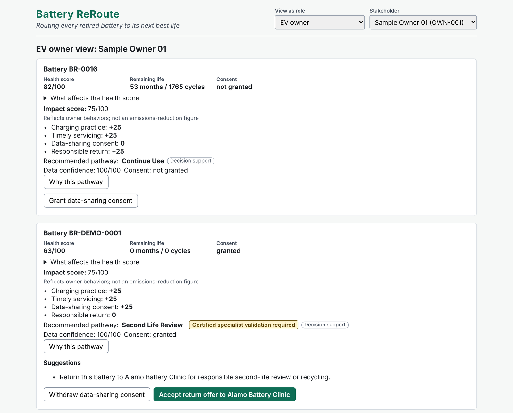
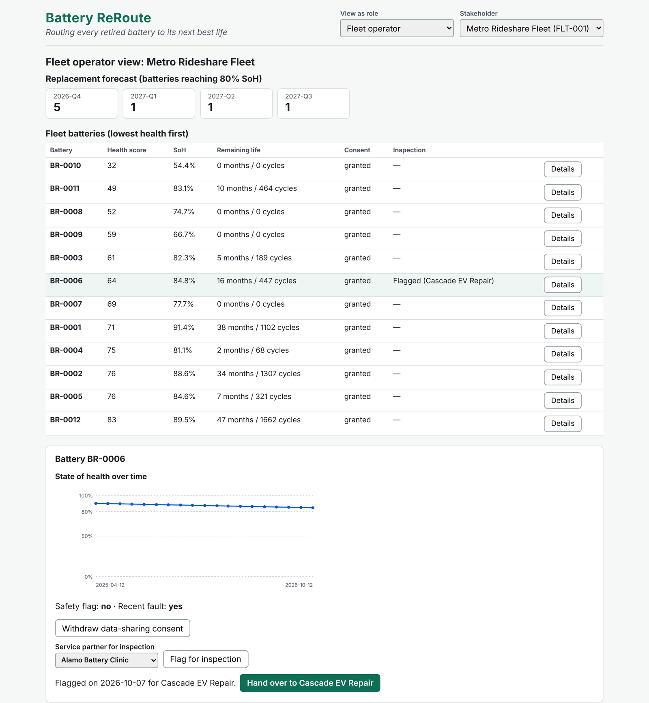
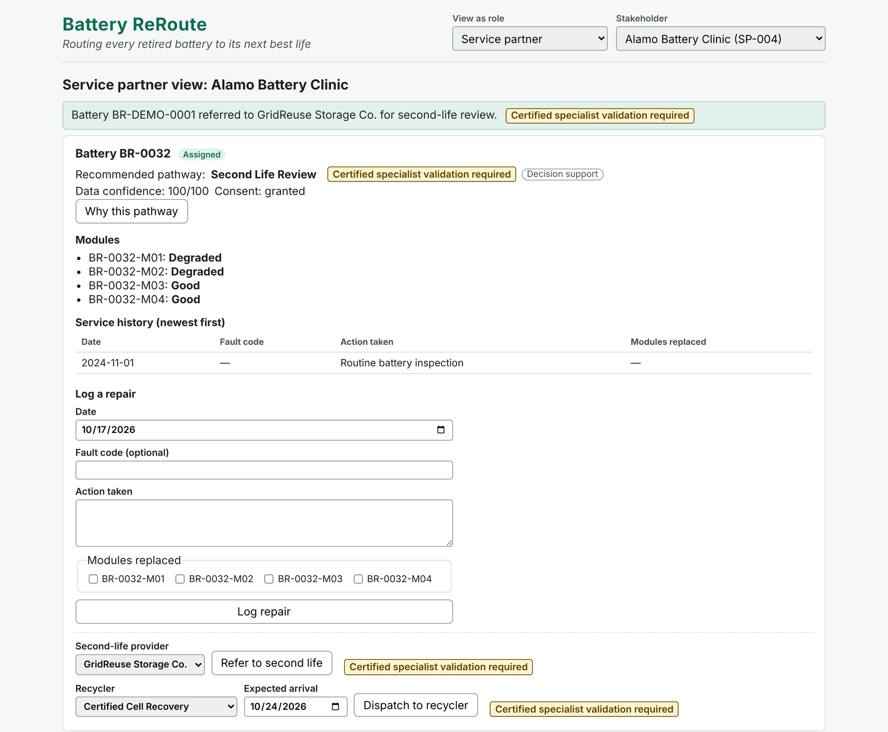
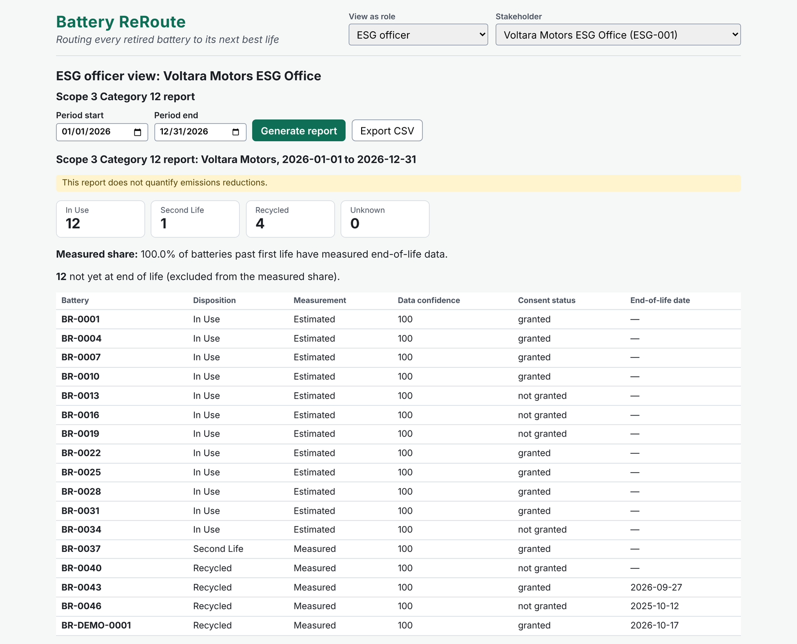

# Battery ReRoute

Battery ReRoute is a prototype of a unified EV battery lifecycle data platform. It joins battery data held by carmakers, owners, fleets, service centers, second-life providers and recyclers into one record per battery (a digital twin). Each stakeholder sees a role-based view of that record through one embeddable plugin.

The platform:

- nudges owners toward healthier charging, earlier repair and responsible return,
- recommends each battery's next best pathway (continue use, inspect/repair, second-life review, certified recycling) as decision support,
- records every end-of-life outcome so a carmaker can report **measured** GHG Protocol Scope 3 Category 12 data instead of estimates.

This is a prototype. It runs on your own computer with **synthetic data only** and makes no calls to outside systems.

> **No login.** The **Role Switcher** at the top of the page stands in for production authentication: pick a role and a stakeholder to see their view. The server listens on `127.0.0.1` only (your own computer) and has no authentication.

## Screenshots

One plugin, one battery record, a different view for each stakeholder. All data is synthetic.

**EV owner:** health score, Impact score with the behaviors behind it, a recommended pathway labeled as decision support, and a one-click return offer.



**Fleet operator:** quarterly replacement forecast, fleet ranked by health, and a state-of-health chart with flag-for-inspection and custody handover.



**Service partner:** module condition, service history, repair logging, and routing to a second-life provider or certified recycler.



**Carmaker ESG officer:** Scope 3 Category 12 report built from recorded end-of-life outcomes, showing which batteries are *measured* versus *estimated*, with no owner identity anywhere.



## Prerequisites

- [Node.js](https://nodejs.org/) 20.19 or later (LTS recommended)
- Windows PowerShell, macOS Terminal or any Linux shell

## Install, seed, start

Run these three commands from the project folder, in this order:

```
npm install
npm run seed
npm start
```

- `npm install` downloads the dependencies (first run takes a few minutes).
- `npm run seed` creates the synthetic dataset in `data/store.json`: about 50 batteries, 3 manufacturers, 6 stakeholder roles. **Run it again any time to reset the demo.**
- `npm start` builds the web page and starts the server. Open the address it prints, normally **http://127.0.0.1:3000**. Press `Ctrl+C` to stop.

Other commands:

```
npm test            # all automated tests, single run
npm run typecheck   # TypeScript check
```

Optional: pin "today" for a repeatable demo (PowerShell):

```
$env:BR_TODAY="2026-10-17"
npm run seed
npm start
```

Use the same `BR_TODAY` for `seed` and `start`. Date fields in the forms default to your computer's date; if you pin a different date, enter dates on or before the pinned one.

## Demo walkthrough: battery BR-DEMO-0001

This traces one battery from its owner through a service partner, a second-life provider and a recycler, ending with the carmaker's Scope 3 report. Start from a fresh seed (`npm run seed`), then `npm start`.

| # | View as role | Stakeholder | What to do | What you should see |
|---|---|---|---|---|
| 1 | EV owner | Sample Owner 01 (OWN-001) | On **Battery BR-DEMO-0001**, click **Grant data-sharing consent**. | Consent changes to *granted*; the Impact score gains the consent +25. The pathway is *Second Life Review* with "Certified specialist validation required" and a "Decision support" label. |
| 2 | EV owner | Sample Owner 01 (OWN-001) | Click **Accept return offer to Alamo Battery Clinic**. | |
| 3 | EV owner | Sample Owner 01 (OWN-001) | Look at the confirmation and the **Returned batteries** section. | "Return accepted, +25 Impact points" with the service partner and date. BR-DEMO-0001 is listed under **Returned batteries** with a final impact score of at least 50 (consent and return both earned). |
| 4 | Service partner | Alamo Battery Clinic (SP-004) | On BR-DEMO-0001, choose **GridReuse Storage Co.** and click **Refer to second life**. | Confirmation with the validation notice. |
| 5 | Second-life provider | GridReuse Storage Co. (SLP-001) | Click **Accept for second life**, then choose **Certified Cell Recovery** and click **Dispatch to recycler**. | Status changes to *Accepted*, then a dispatch confirmation. |
| 6 | Recycler | Certified Cell Recovery (RCY-001) | Click **Log intake**, then enter materials (for example lithium 45, nickel 120, cobalt 30) and click **Log materials recovered**. | Intake status *Received*, then a confirmation of the Certified Recycling record. |
| 7 | ESG officer | Voltara Motors ESG Office (ESG-001) | Keep the period **1 January to 31 December of the current year** (manufacturer **Voltara Motors**), click **Generate report**, then **Export CSV**. | BR-DEMO-0001 shows **Recycled** and **Measured**. The "not yet at end of life" count is shown separately from the measured share, and a CSV file downloads. No owner names or IDs appear anywhere in the ESG view or the CSV. |

### Optional: fleet handover

| # | View as role | Stakeholder | What to do |
|---|---|---|---|
| 1 | Fleet operator | Metro Rideshare Fleet (FLT-001) | See the replacement forecast and fleet list (lowest health first). Click **Details** on **BR-0006** to see its state-of-health chart. It is already flagged for Cascade EV Repair. |
| 2 | Service partner | Cascade EV Repair (SP-002) | BR-0006 appears as **Referred for inspection** with repair and routing disabled: "Custody handover from the Fleet_Operator is pending". |
| 3 | Fleet operator | Metro Rideshare Fleet (FLT-001) | On BR-0006, click **Hand over to Cascade EV Repair**. |
| 4 | Service partner | Cascade EV Repair (SP-002) | BR-0006 is now **Assigned** and a repair can be logged. |

## How it is built

| Folder | Contents |
|---|---|
| `src/core/` | Pure domain logic: types, validation, health model, pathway rules, nudges, impact score, second-life fit, replacement forecast, Scope 3 report and CSV, role access and projection, commands. No clock, no I/O. |
| `src/server/` | Express API server. Every request passes role-context middleware; all field filtering and consent gating happen on the server; ESG responses pass a final no-owner-identity check. |
| `src/web/` | React host page, Role Switcher and the Plugin with one view per role. |
| `scripts/` | Deterministic seed script and its invariant checks. |
| `test/` | Unit, integration (including the full walkthrough above and the fleet handover) and web tests. |
| `.kiro/specs/battery-reroute/` | Requirements, design and task list. |

## Limits of the prototype

- Synthetic data only; no real BMS, carmaker, passport or recycler integration.
- No authentication: the Role Switcher selects who you are.
- Pathway recommendations are rule-based decision support; certified specialists validate safety and final disposition.
- The Scope 3 report covers disposition and measurement coverage only. It does not quantify emissions reductions.
